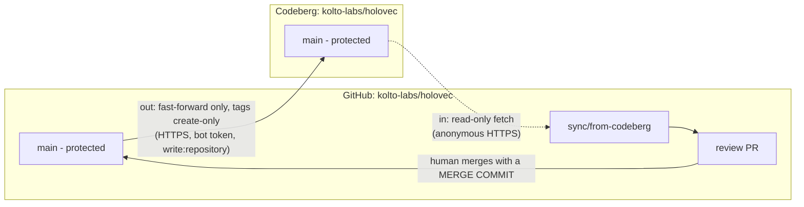

# Syncing GitHub and Codeberg

GitHub `kolto-labs/holovec` is the hub. Codeberg `kolto-labs/holovec` is a second home.
Both directions are automated, and neither direction can overwrite or delete anything on the other side.

| Direction | Workflow | Trigger | What it may do |
|---|---|---|---|
| GitHub to Codeberg | `.github/workflows/sync-codeberg-out.yml` | push to `main`, any tag, manual | fast-forward `main`; create tags that do not exist yet |
| Codeberg to GitHub | `.github/workflows/sync-codeberg-in.yml` | daily 05:17 UTC, manual | read-only fetch; publish `sync/from-codeberg` and open one PR |

Code: `scripts/codeberg-sync-out.sh`, `scripts/codeberg-sync-in.sh`, `scripts/codeberg-sync-lib.sh`.
Offline test: `scripts/codeberg-sync-test.sh`.

## Architecture



```
GitHub main ──push event──> [out] preflight ──ff-only──────────────> Codeberg main
                                  │ refuses if Codeberg is ahead / diverged / tag differs
Codeberg main ──daily read──> [in] is C an ancestor of GitHub main?
                                  │ yes: nothing to do
                                  │ no : ff-push C to sync/from-codeberg, open ONE PR
                                  ▼
                           human reviews, merges with a merge commit
                                  ▼
                   GitHub main now contains C  ──> [out] fast-forwards Codeberg (a no-op for C itself)
```

## Why this tooling

The preference is maintained standard tooling over hand-rolled sync. The options were:

1. **Forgejo push mirror** (Codeberg to GitHub). Rejected for the inbound path. It makes Codeberg write to GitHub on its own schedule, including `main`, with mirror semantics, which violates "never push to `main`" and has no human review step. (Behaviour described from upstream knowledge; Codeberg's page on push mirrors could not be fetched, see Unverified.)
2. **Forgejo pull mirror** (Codeberg pulls from GitHub). Rejected for a two-way setup: a pull-mirror repository is a read-only copy, so Codeberg-only commits cannot exist there at all. It is a good fit if you decide Codeberg should only ever be a read-only copy. `tea repos migrate --mirror` (checked with `--help`) creates one, and the live Codeberg API reports `mirrors_disabled: false` and `migrations_disabled: false` today (checked 2026-11-24). Whether Codeberg's policy allows pull mirrors of a repo this size is not verified.
3. **Third-party GitHub Actions that mirror to another forge.** Rejected. Their defaults tend to be `--mirror`/`--force` semantics, which is the opposite of the requirement, and each is another supply-chain dependency. I could not check their maintenance status from this sandbox (GitHub API access is limited to attached repos). The only action used is first-party `actions/checkout`, pinned to the full SHA of v6.1.0 (`d23441a48e516b6c34aea4fa41551a30e30af803`, resolved with `git ls-remote` against the tag).
4. **Plain `git push` of an explicit `<sha>:refs/heads/main` refspec from a workflow, preceded by preflight checks.** Chosen for outbound. Git itself refuses non-fast-forward updates and the script checks ancestry first, so the refusal is double-enforced. Inbound is a read-only `git fetch` plus a PR, using only `git` and `gh api` (REST).

No bespoke protocol, no daemon, no state files: the only state is the git history on both sides.

### Why an HTTPS token and not an SSH deploy key

A deploy key is repo-scoped, which is better least-privilege in principle. It needs pinned host keys, and Codeberg's published fingerprints could not be fetched here, so pinning would have been unverifiable. HTTPS uses the normal TLS CA chain and needs no host key. Least privilege is recovered a different way: use a dedicated bot account that is a member of only a team with write access to only this repo, and give its token only the `write:repository` scope. Then a leaked token can write to this one repo and nothing else. An SSH variant is described under "Alternative: SSH deploy key".

## Guarantees and where they are enforced

| # | Guarantee | Enforced by |
|---|---|---|
| 1 | Outbound never forces, mirrors, prunes or deletes | No such flag or `+` refspec exists in the scripts (test case 1 greps for them); explicit `sha:ref` refspecs |
| 2 | Non-fast-forward fails closed with a message | Ancestry preflight (`merge-base --is-ancestor`) before any push; exit code 3; git's own refusal as a second layer |
| 3 | Only `main` and tags go outbound | Only `refs/heads/main` and `refs/tags/*` are ever named in a refspec; tags whose commit is not on `main` are skipped |
| 4 | An existing differing tag is an error, never an overwrite | Preflight compares tag object ids; any mismatch aborts the whole run before pushing anything |
| 5 | Preflight is all-or-nothing | All classification happens first; any error means nothing is pushed |
| 6 | Dropping Codeberg history is impossible | Push only when Codeberg main is an ancestor of the new main and `rev-list S..R` is 0 |
| 7 | Inbound never writes `main` or any protected branch | The only push target is the constant `refs/heads/sync/from-codeberg`; fast-forward only; if that branch diverged (a human added commits), it is left alone |
| 8 | Inbound is read-only toward Codeberg | Anonymous HTTPS `ls-remote` and `fetch` into a private ref `refs/codeberg-sync/main`; nothing is checked out or executed |
| 9 | No ping-pong between hosts | Loop guard below |
| 10 | Manual runs are dry by default | `dry_run` input defaults to `true`; scripts default `DRY_RUN=true` and reject any other value than `true`/`false` |
| 11 | Least privilege, no leaks | `permissions: {}` at workflow level; `contents: read` outbound; `contents: write` + `pull-requests: write` inbound only; token passed via `GIT_CONFIG_*` env (never argv or disk), host-scoped to `codeberg.org`, masked; no `${{ }}` interpolation inside `run:` blocks |
| 12 | Untrusted remote data | Remote shas and ref names validated by regex; Codeberg commit messages are never interpolated into the PR (only shas and a count); the PR body is a fixed template |
| 13 | No concurrent runs | One `concurrency` group `sync-codeberg` shared by both workflows, `cancel-in-progress: false` |
| 14 | Only the canonical repo runs it | `github.repository == 'kolto-labs/holovec'`; automatic runs also need repo variable `CODEBERG_SYNC_ENABLED=true` |
| 15 | Destination can only be Codeberg | URL must match `^https://codeberg\.org/<owner>/<repo>\.git$` (a test-only switch allows local bare repos) |

### Loop guard

- **Merge commit closes the loop.** The sync PR points at the Codeberg head `C`. Merging it with a merge commit puts `C` in GitHub `main`'s history. Next inbound run: `C` is an ancestor, so nothing happens. Next outbound run: Codeberg `main` is an ancestor of GitHub `main`, so it fast-forwards.
- **GITHUB_TOKEN pushes do not trigger workflows**, so publishing `sync/from-codeberg` cannot start the outbound workflow. Merging the PR is a push to `main` by a human, which triggers outbound once, and that run is a fast-forward.
- **Closed-unmerged PRs are not reopened.** If a PR for the same Codeberg head sha was closed without merging, inbound logs a warning and stops.
- **Squash or rebase merge is detected.** If the trees are identical but the histories differ, inbound opens no PR and warns; outbound will refuse (diverged). Use the runbook.
- **Existing open PR is reused.** Inbound only fast-forwards the branch, which refreshes the PR.
- Set the repository to **auto-delete head branches** after merge, and allow **merge commits** (squash/rebase may stay enabled for normal PRs, but must not be used on the sync PR).

### Test evidence

`scripts/codeberg-sync-test.sh` builds throwaway local bare repos named "GitHub" and "Codeberg" and a stub `gh`. Final run on 2026-11-24: `passed=42 failed=0`. Excerpts:

```
PASS  real push bootstraps main
PASS  fast-forward push succeeds
    main: fast-forward de4b1cb... -> 240abd3... (1 new commits)
PASS  refuses when Codeberg is ahead
    ERROR: REFUSED: Codeberg main (b4b0443...) is AHEAD of GitHub main (240abd3...). Pushing would drop Codeberg-only history. ...
    Nothing was pushed.
PASS  refuses diverged history with non-zero exit
    ERROR: REFUSED: Codeberg main (b4b0443...) and GitHub main (9166cca...) have DIVERGED (merge-base: 240abd3...). Nothing was pu...
PASS    Codeberg main untouched (Codeberg-only commit survives)
PASS  refuses to overwrite a differing tag
PASS    preflight is all-or-nothing: main not pushed either
PASS  IN: Codeberg ahead -> branch pushed
PASS    GitHub main untouched
PASS  OUT after merge-commit merge -> fast-forward Codeberg
PASS  IN: rejected PR at same sha -> not reopened
PASS  IN: identical trees -> warn, no branch, no PR
PASS  IN: diverged sync branch -> left alone, exit 0
```

One real-network check: with the Codeberg repo not yet created, `DRY_RUN=true scripts/codeberg-sync-out.sh` against `https://codeberg.org/kolto-labs/holovec.git` failed closed (`could not read Username ... terminal prompts disabled`, then "Does the repo exist and is it reachable?", exit 1). It is never treated as an empty repo.

Also run: `shellcheck -x scripts/codeberg-sync-*.sh`, `actionlint` and `yamllint` on both workflows (all clean).

## One-time setup (manual steps for the maintainer)

The Codeberg repo is created by a person, not by the workflow. Creating a repo under an org needs an org-level token, and no automation should hold one. Everything below is done once.

### 1. Create the bot account and an empty repo on Codeberg

1. The `kolto-labs` Codeberg organization already exists and is public.
2. Create a Codeberg account for the bot, for example `kolto-labs-sync`. Add it to an org team that has **write access to the `holovec` repository only** (not "all repositories").
3. Install and log in a CLI as an org owner. Either CLI works (the flags below come from each tool's `--help`):

   ```sh
   # tea (official Gitea CLI, works with Forgejo): token from Codeberg > Settings > Applications
   tea logins add --name codeberg --url https://codeberg.org --token "$YOUR_OWNER_TOKEN"

   # berg (codeberg-cli)
   berg auth login --token "$YOUR_OWNER_TOKEN"
   ```

4. Create the repository **empty**. Do not initialize it with a README, license or .gitignore: any commit created on the Codeberg side makes the first sync a "Codeberg is ahead" refusal.

   ```sh
   tea repos create --name holovec --owner kolto-labs --description "HoloVec: Old Republic reference dataset (mirror of GitHub kolto-labs/holovec)"
   # tea repos create has --init (leave it off) and creates a public repo unless --private is given

   # or with berg:
   berg repo create --org kolto-labs --name holovec --private public --description "HoloVec: Old Republic reference dataset (mirror of GitHub kolto-labs/holovec)"
   # do not pass --default-branch: its help says it initializes the repository
   ```

   Repository settings to check on the new repo: Git LFS enabled (the instance reports `lfs_disabled: false`), issues/wiki/PRs as you like. This repo is mostly an LFS payload (see "Size").

5. Log in to Codeberg as the bot, then create an access token with **only the `write:repository` scope** (Settings > Applications > Generate New Token). Name it `github-sync`. Copy it once.

### 2. Add the GitHub secret and variables

```sh
# secret: read from stdin so it never lands in shell history
gh secret set CODEBERG_TOKEN --repo kolto-labs/holovec
gh variable set CODEBERG_USER --repo kolto-labs/holovec --body "kolto-labs-sync"
```

`gh variable set` was checked with `--help`. `gh secret set` is the standard counterpart; its `--help` could not be run in this sandbox (a local hook blocked the call), so confirm its flags with `gh secret set --help`.

Allow Actions to open pull requests (needed by the inbound workflow). In the UI: Settings > Actions > General > "Allow GitHub Actions to create and approve pull requests". With the REST API:

```sh
gh api -X PUT repos/kolto-labs/holovec/actions/permissions/workflow \
  -f default_workflow_permissions=read -F can_approve_pull_request_reviews=true
```

(Organization policy can override this. The API call is the documented endpoint but was not run.)

Optional variable: `CODEBERG_REPO_URL` (default `https://codeberg.org/kolto-labs/holovec.git`; must still match the Codeberg URL pattern).

### 3. Branch protection on both hosts

GitHub `main`: require a pull request, block force pushes and deletion. The sync workflows do not need to bypass any rule, because inbound writes only `sync/from-codeberg`. Allow merge commits and enable "Automatically delete head branches".

Codeberg `main`: restrict pushes to the bot and to named humans, so nobody else can write to it by accident. `tea branches protect` (checked with `--help`) blocks push and merge on a branch; to whitelist the bot, call the branch-protection endpoint. These body fields were checked against Codeberg's live API schema on 2026-11-24 (`branch_name`, `rule_name`, `enable_push`, `enable_push_whitelist`, `push_whitelist_usernames`):

```sh
tea api -X POST repos/kolto-labs/holovec/branch_protections -d '{
  "branch_name": "main",
  "rule_name": "main",
  "enable_push": true,
  "enable_push_whitelist": true,
  "push_whitelist_usernames": ["kolto-labs-sync", "YOUR_CODEBERG_USERNAME"]
}'
```

That schema has no force-push switch, which is consistent with protected branches rejecting force pushes in upstream Gitea/Forgejo. I did not test this against a real Codeberg repo.

### 4. First sync (bootstrap of the empty repo)

```sh
# 1. dry run: reads Codeberg anonymously, pushes nothing; needs no secret
gh workflow run sync-codeberg-out.yml --repo kolto-labs/holovec -f dry_run=true
# 2. read the log: expect "Codeberg repo is empty: bootstrap push of main"
# 3. real push of main plus tags (also uploads LFS objects first)
gh workflow run sync-codeberg-out.yml --repo kolto-labs/holovec -f dry_run=false
# 4. dry run of the inbound side
gh workflow run sync-codeberg-in.yml --repo kolto-labs/holovec -f dry_run=true
# 5. turn on automatic runs (push, tags, daily schedule)
gh variable set CODEBERG_SYNC_ENABLED --repo kolto-labs/holovec --body true
```

The two `gh workflow run` flags come from `gh workflow run --help` (`-f key=value`).

Until `CODEBERG_SYNC_ENABLED` is `true`, automatic runs are skipped. Scheduled workflows run only on the default branch, and GitHub disables schedules after about 60 days without repository activity in public repos (upstream GitHub behaviour, not tested here): re-enable under the Actions tab if that happens.

### Size

At commit `ed30c52`: about 4 MiB of git objects plus 124 Git LFS objects of about 177 MiB in total (largest: `data/exarch-mission-metadata.jsonl` and `unified/corpus.parquet`, 41 MB each). Codeberg's per-repo quota and LFS limits are not verified (see Unverified); if a push is rejected for size, the outbound run fails with "LFS upload to Codeberg failed; refs NOT pushed" and no refs change.

## Alternative: SSH deploy key

Repo-scoped and write-capable keys exist on Forgejo (`push_whitelist_deploy_keys` is in the branch-protection schema, and `POST /repos/{owner}/{repo}/keys` takes `key`, `read_only`, `title`). It is not wired in because the host key must be pinned: take the SSH host-key fingerprints from Codeberg's own documentation, compare them with `ssh-keyscan -t ed25519 codeberg.org | ssh-keygen -lf -`, and write a `known_hosts` entry only if they match. Never accept the key blindly. `berg keys ssh add` attaches a key to a user profile, not to a repo, so a deploy key must be added through the web UI or the API call above.

## Recovery runbook

Never use `--force` in automation. All of the following are human actions.

**A. "Codeberg main is AHEAD" (outbound refused).** Expected after someone commits on Codeberg. Wait for the daily inbound run (or run `sync-codeberg-in` manually with `dry_run=false`), review the PR on `sync/from-codeberg`, merge it with a **merge commit**. Outbound then fast-forwards by itself.

**B. "DIVERGED" (both sides have unique commits).** Same cure as A: the sync PR carries the Codeberg head, and merging it produces a merge commit that contains both histories. If the PR shows conflicts, resolve them locally:

```sh
git remote add codeberg https://codeberg.org/kolto-labs/holovec.git   # once
git fetch codeberg main
git switch -c fix/merge-codeberg origin/main
git merge --no-ff codeberg/main          # resolve conflicts, commit
git push origin fix/merge-codeberg       # open a PR, merge with a MERGE COMMIT
```

**C. Squash or rebase merged the sync PR** (inbound warns "identical content but different history"). Content is already the same; only the ancestry link is missing. Record it with an empty-content merge:

```sh
git fetch codeberg main
git switch -c fix/link-codeberg origin/main
git merge --no-ff -s ours codeberg/main -m "Link Codeberg history (content already merged by squash)"
git push origin fix/link-codeberg        # PR, merge with a MERGE COMMIT
```

Use `-s ours` only when you have confirmed the trees are identical (`git diff --stat origin/main codeberg/main` is empty). If they are not, use recipe B instead.

**D. Tag conflict** (a tag name exists on Codeberg with a different target). Decide which tag is right. To make Codeberg match GitHub you must delete the Codeberg tag yourself with an authenticated account (`git push codeberg :refs/tags/NAME`), then re-run outbound. Automation will not do it.

**E. Someone force-pushed Codeberg and rewrote history.** The scripts treat that as divergence and stop. Decide by hand which history is authoritative. If GitHub is, a maintainer restores Codeberg `main` with one deliberate force push from their own account, with the Codeberg branch protection temporarily relaxed, and then restores it. If Codeberg is authoritative, merge it into GitHub as in B.

**F. Inbound branch stuck.** If `sync/from-codeberg` has diverged from Codeberg `main` (inbound warns and does nothing), merge or delete that branch on GitHub, then re-run inbound.

**G. Inbound push failed because the incoming commits change `.github/workflows`.** `GITHUB_TOKEN` cannot push workflow-file changes, so the run fails. This is deliberate: bring those commits over by hand in a PR from your own account.

## CLI cheat sheet (every command here had `--help` run in this sandbox)

| Task | tea 0.16.0 | berg 0.5.5 |
|---|---|---|
| Log in | `tea logins add --name codeberg --url https://codeberg.org --token ...` | `berg auth login --token ...` |
| Create empty repo | `tea repos create --name holovec --owner kolto-labs` | `berg repo create --org kolto-labs --name holovec --private public` |
| Check repo | `tea repos search holovec` | `berg repo info` (inside a clone) |
| Protect `main` | `tea branches protect main`, plus `tea api -X POST .../branch_protections -d ...` | no branch-protection command found; use `tea api` |
| Raw API call | `tea api <endpoint>` (`-X`, `-f`, `-F`, `-d`) | `berg api` only has `version` |
| Pull mirror (alternative design) | `tea repos migrate --mirror --lfs --clone-url ... --name ... --owner ...` | `berg repo migrate` |

`tea repos search` was listed by `tea repos --help` but its own `--help` was not run.

## Unverified

Everything here is stated honestly as not confirmed against a live Codeberg repository.

1. **Codeberg's current docs could not be read.** Fetches of `docs.codeberg.org` (Git LFS page, push-mirror page) were refused by the permission prompt, so I did not retry or route around it. Not verified from docs: per-repo and LFS storage quotas, per-file limits, Codeberg's policy on pull mirrors and push mirrors, and Codeberg's published SSH host-key fingerprints.
2. **Verified from Codeberg's live public API on 2026-11-24:** instance version string `17.0.0-121-39320c0+gitea-1.22.0`; `mirrors_disabled`, `migrations_disabled`, `lfs_disabled` all `false`; `default_max_blob_size` 10485760 (that is an API content-display limit, not a push limit); the branch-protection and deploy-key request schemas quoted above; org `kolto-labs` has no `holovec` repo yet (HTTP 404).
3. **Git LFS over HTTPS to Codeberg with the `http.<url>.extraheader` auth method.** The git side is tested locally. The LFS upload (`git lfs push codeberg-sync <sha>`) and the Codeberg-to-GitHub LFS path in the inbound script could not be exercised without a server and credentials. They fail closed (refs are pushed only after LFS succeeds).
4. **That `write:repository` is sufficient** for `git push` and LFS upload, and that a token created by a team-limited bot cannot touch other repos. Standard Forgejo behaviour, not tested.
5. **Branch-protection effect on force pushes** (see section 3), and the GitHub endpoint for letting Actions create PRs.
6. **Real GitHub Actions run.** `actionlint` and `yamllint` pass and the scripts are tested locally, but the workflows have not run on GitHub. The first run should be a manual `dry_run=true`.
7. **Third-party mirroring actions' maintenance status** was not checked (GitHub API access from this sandbox is limited to attached repos). They are rejected on design grounds, not on maintenance.
8. **`gh secret set --help` was not run** (a local hook blocked the call); the flags used are the common ones.
