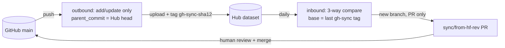

# Two-way sync with the Hugging Face dataset

GitHub (`kolto-labs/holovec`) is the hub. The Hugging Face dataset
`kolto-labs/holovec` (repo type `dataset`) is a mirror that can also receive
edits. Two workflows keep them aligned without ever overwriting or deleting
anything on either side without a human looking at it.

| Direction | Workflow | Trigger | What it does |
|---|---|---|---|
| GitHub to Hub | `.github/workflows/sync-huggingface-outbound.yml` | push to `main`, manual | Adds and updates files on the Hub. Never deletes. Fails closed if the Hub moved. |
| Hub to GitHub | `.github/workflows/sync-huggingface-inbound.yml` | daily 05:17 UTC, manual | Opens a pull request on `sync/from-hf-<rev>` with Hub-side changes. Never touches `main`. |

Code: `scripts/hf_sync.py` (driver), `scripts/hf_sync_core.py` (pure logic),
tests in `tests/test_hf_sync.py` (31 tests, a fake Hub, no network, no token).

## Architecture

```
                       push to main                        daily / manual
                            |                                    |
                            v                                    v
  GitHub main ------> [outbound workflow]                [inbound workflow]  <------ Hub head
   (hub of truth)       stage tree + card                  list Hub tree, read             |
        ^               compare with Hub head              gh-sync-* tag = base            |
        |               guards, dry_run                    3-way compare                   |
        |                    |                             write HF-only changes           |
        |                    | upload_folder(               into a work tree                |
        |                    |   parent_commit=head,              |                        |
        |                    |   no delete_patterns)              v                        |
        |                    v                              push NEW branch                |
        |            Hub dataset repo  <--- tag gh-sync-<sha12>   sync/from-hf-<rev>       |
        |                    ^                                    |                        |
        |                    |                                    v                        |
        +---- human merges --+------------------------------ pull request  <--------------+
              (branch protection: PR required)
```



### How "what changed" is decided

Every successful outbound run puts a tag `gh-sync-<first 12 chars of the GitHub
commit>` on the Hub commit that corresponds to that GitHub commit. That tag is
the shared marker ("base") both workflows use:

- Hub head == tagged commit: nobody edited the Hub since the last sync. Outbound
  may push. Inbound has nothing to do.
- Hub head is past the tagged commit: someone edited the Hub. Outbound refuses.
  Inbound compares three trees (base = GitHub at the tagged commit, main, Hub head).
  Files the Hub changed and GitHub did not are proposed in a PR. Files both sides
  changed are listed as conflicts and not applied.

### Which files are synced

All tracked files except `.git*` metadata (`.gitattributes`, `.github/`,
`.gitmodules`), `staging/` and `__pycache__`. `.gitattributes` is excluded because
it holds git-lfs rules; the Hub manages its own `.gitattributes`. Symlinks and
submodules abort the run. A checkout that contains Git LFS pointer files instead
of real content aborts the run (the workflow checks out with `lfs: true`).

Current size of the staged tree (measured in this repo today): 476 files,
195,467,415 bytes. Largest: `data/exarch-mission-metadata.jsonl` 41.3 MB,
`unified/corpus.parquet` 41.1 MB, `data/wookieepedia-broad-references.jsonl`
33.7 MB. No file is near any Hub size limit; the biggest directory has 110 files.

### The dataset card

The Hub needs `README.md` with YAML front matter; GitHub's `README.md` has none
and stays clean. At sync time `build_card()` writes, into a staging directory
only, `---` + the contents of `catalog/dataset.yaml` (plus `pretty_name: HoloVec`
if absent) + `---` + the GitHub README body. The output is deterministic and is
checked with `huggingface_hub.DatasetCard`. Inbound strips the front matter before
comparing and before writing, so generating the card never creates a diff. The
front matter is GitHub-owned: change `catalog/dataset.yaml`, not the Hub card.
Relative links in the README (for example `docs/usage.md`) are not rewritten and
will not resolve on the Hub card page.

## Tool choice and why

Chosen: the `huggingface_hub` Python library, `HfApi.upload_folder(...,
parent_commit=<hub head>)` with no `delete_patterns`, plus `list_repo_commits`,
`list_repo_refs`, `list_repo_tree`, `create_tag`, `hf_hub_download`. Pinned to
`huggingface_hub==2.4.0` (the version installed and read in the sandbox).
`parent_commit` is the Hub's own optimistic-concurrency check: per the 2.4.0
docstring, the commit fails if the revision no longer points at `parent_commit`.
That is what makes "Hub has commits GitHub lacks" fail closed even if it happens
between the check and the upload. The driver adds only the comparison logic and
the PR plumbing that no standard tool provides.

Rejected, with the reason:

- `huggingface/hub-sync` Action (the one the Hub docs recommend): its documented
  behaviour is that it mirrors deletions, which violates the no-delete rule. Not
  used, so not pinned.
- `hf upload`: no `parent_commit` option, so it cannot fail closed. Its `--delete`
  flag is the thing we must never use.
- `hf upload-large-folder`: resumable multi-commit uploader built for huge folders;
  `parent_commit` cannot span its commits. The tree is 195 MB, so one atomic commit
  is better.
- `hf sync`: in 2.4.0 it syncs a local directory with a bucket, not a repo.
- `git push` to the Hub git remote: would need one shared history between GitHub
  and the Hub, the generated card makes the trees differ by design, and mirror-style
  pushes are the failure mode we are avoiding.

## Guarantees

1. Outbound only adds and updates. There is no `delete_patterns`, no `--delete`, no
   `--force`, no `--mirror`, no `--prune`, no `create_pr`. A test greps the scripts for
   these strings. A file removed from GitHub stays on the Hub and is reported as
   "Hub-only (left untouched)".
2. If the Hub head is not the commit GitHub last tagged, outbound stops with a
   non-zero exit and an explanation. It never overwrites Hub-side edits.
3. Inbound never pushes to `main` or any existing branch and never force-pushes. It
   pushes a new `sync/from-hf-<12 chars of Hub rev>` branch with a plain refspec and
   opens a PR. Older open inbound PRs are closed with a comment; branches are kept.
4. Loop guards: (a) Hub head equals a tagged commit, so inbound exits; (b) the Hub
   change is already in `main`, so there is nothing to apply; (c) if applying Hub
   content produces no `git diff`, no branch is created; (d) after an inbound PR is
   merged, outbound sees that Hub and GitHub trees are equal (card compared with
   front matter normalised), uploads nothing and only adds the tag.
5. Outbound sanity guards (before any write): refuse an empty tree or zero bytes;
   refuse if the staged file count or total size is more than `max_drop_percent`
   (default 10) below the Hub; refuse LFS pointers, symlinks, submodules. Manual
   runs default to `dry_run: true`, which prints add/update/unchanged/Hub-only
   lists and changes nothing. Push-triggered runs are not dry runs.
6. Both workflows share `concurrency: group: huggingface-sync` with
   `cancel-in-progress: false`: runs queue and never overlap. `permissions` is
   `contents: read` for outbound; inbound has `contents: write` and
   `pull-requests: write`, needed to push the review branch and open the PR.
7. Only secret that is required: `HF_TOKEN`. It is passed through the environment, never on a command
   line, never printed. Third-party actions are pinned to full commit SHAs
   (`actions/checkout` v7.0.1 and `actions/setup-python` v7.1.0, resolved with
   `git ls-remote` on 2026-11-24). All Hub content is data: hashed, compared and
   written as bytes; no `eval`, no `shell=True`, no execution of fetched files;
   Hub paths containing `..`, absolute paths, backslashes or `.git` are ignored; the
   `workflow_dispatch` string inputs go through env vars and are validated as 40-char
   hex shas by the script.
8. Without `HF_TOKEN` both workflows do nothing harmful: outbound only builds and
   validates the staging tree and card; inbound exits.

## Manual steps for you

1. Decide visibility. The workflow creates the repo as private unless `HF_PRIVATE` is
   a false-word (`false`, `0`, `no`, `off`; case and surrounding whitespace do not
   matter, anything unrecognised stops the run). Making a repo public is your decision;
   the default is private. Optional variable `HF_REPO_ID` overrides `kolto-labs/holovec`.
   See "Where the settings come from" below for org-level versus repo-level values.
2. Easiest and tightest path: create the empty dataset repo yourself on the Hub
   (`kolto-labs/holovec`, type Dataset, private) so the token does not need
   create-repo rights. If you skip this, the outbound workflow creates it.
3. Create the token: Hugging Face, Settings, Access Tokens, New token, type
   **Fine-grained**. Under repositories, add only `kolto-labs/holovec` (dataset) with
   write access to repo contents. No org-wide, inference or other permissions. If you
   want the workflow to create the repo, the token also needs create-repo permission
   in the `kolto-labs` namespace; prefer step 2 instead.
4. Add it as a GitHub secret named `HF_TOKEN`, either once for the whole organization
   (org Settings, Secrets and variables, Actions, New organization secret, with
   repository access that includes `holovec`) or on this repository only. A repository
   secret overrides an organization secret of the same name.
5. GitHub branch protection on `main` (Settings, Rules, Rulesets, or Branches): require a
   pull request before merging, block force pushes, restrict deletions. Inbound
   relies on this; it is not something a workflow can set for you.
6. Settings, Actions, General, Workflow permissions: tick "Allow GitHub Actions to
   create and approve pull requests", otherwise inbound cannot open the PR (the branch
   is still pushed and you can open it by hand).
7. Bootstrap, see below. Always start with a dry run.

## Where the settings come from

The workflows read `secrets.HF_TOKEN`, `secrets.HF_PRIVATE`, `vars.HF_PRIVATE` and
`vars.HF_REPO_ID`. For each name, GitHub itself picks the value from the lowest level
that defines it: environment, then repository, then organization. So an organization
value is used by default, and defining the same name on this repository overrides it
without any workflow change. (GitHub docs, "Secrets reference" and "Variables
reference".)

| Setting | Kinds accepted | Order of precedence |
| --- | --- | --- |
| `HF_TOKEN` | secret | repository secret, then organization secret |
| `HF_PRIVATE` | secret or variable | secret (repository, then organization), then variable (repository, then organization), then the private default |
| `HF_REPO_ID` | variable | repository variable, then organization variable, then `kolto-labs/holovec` |

Things to know:

- An organization secret or variable must have `holovec` in its repository access
  policy, and organization-level secrets are not available to private repositories on
  GitHub Free. If the token is unreachable the workflows say so and do nothing harmful
  (outbound only validates, inbound exits).
- A secret beats a variable of the same name across levels. If the org defines
  `HF_PRIVATE` as a secret and this repo defines it as a variable, the org secret wins.
  To override per repository, use the same kind at the repository level.
- A secret value is masked in logs, so a secret `HF_PRIVATE` of `true` or `false` turns
  every `true`/`false` in the run log into asterisks. Harmless, but a variable keeps
  logs readable; `HF_PRIVATE` is not sensitive.
- Manage organization secrets from the CLI with `gh secret set HF_TOKEN --org kolto-labs
  --repos holovec` (needs the `admin:org` scope) and variables with `gh variable set`.
  Not run here; check `--help` first.

## Bootstrap the first sync

Run Actions, `sync-huggingface-outbound`, Run workflow, leave `dry_run` checked, read
the log. Then:

- Hub repo empty (only the Hub-managed `.gitattributes`, or a default card with no
  body, or does not exist yet): uncheck `dry_run` and run again. It uploads
  everything in one commit and tags it. Done.
- Hub repo not empty: the run refuses and prints what differs. Choose one:
  - Pull Hub content in first: run `sync-huggingface-inbound` (dry run first, then
    for real). With no tag yet it proposes Hub-only files and lists differing files as
    conflicts without applying them. Merge the PR, then run outbound; if the trees now
    match, it only tags.
  - Or adopt: if you have reviewed the Hub repo and every file it shares with GitHub
    is identical, run outbound with `adopt_head` set to the full 40-char Hub head sha
    printed in the refusal message. It refuses if any shared file differs, so it can
    only add. Hub-only files are kept.

## Recovery runbook (diverged remote)

Symptom: outbound fails with "the Hub has commits that GitHub does not have".

1. Run `sync-huggingface-inbound` with `dry_run` checked; read the proposed lists.
2. Run it again unchecked. Review and merge the PR `sync/from-hf-<rev>`. Conflicts
   (changed on both sides) are not in the PR: resolve them by editing on the PR
   branch, or revert the Hub-side file on the Hub.
3. The merge triggers outbound. Trees now match, so it only tags the Hub head.
4. If the failure says the card front matter was edited on the Hub: move that change
   into `catalog/dataset.yaml` on GitHub (or revert it on the Hub), then re-run.
5. Do not delete `gh-sync-*` tags on the Hub, and do not create them by hand: they are
   the sync marker. If the marker is lost, use the bootstrap path for a non-empty Hub
   (inbound, merge, then outbound or `adopt_head`).
6. A failure after "uploaded as Hub commit" but before "tagged" is safe to re-run:
   the trees are equal, so the next run only adds the missing tag.
7. A Hub file that should be removed: delete it on the Hub by hand (or via a reviewed
   inbound PR once GitHub no longer has it). Outbound will never do it for you.

## Unverified

Nothing here ran against a real Hub repo or a real GitHub Actions runner: the sandbox
has no `HF_TOKEN` and cannot run Actions.

- Verified: 48 pytest tests with a fake Hub pass (including the `HF_PRIVATE` value parsing); `actionlint` (with `shellcheck`) and
  `yamllint` pass on both workflows; the staging and card generator ran on the real
  repo (476 files, 195,467,415 bytes, valid `DatasetCard`); `hf_sync.py outbound
  --dry-run` ran anonymously against `kolto-labs/holovec` and reported "would create
  private dataset repo and upload 476 files".
- Anonymous checks cannot tell whether `kolto-labs/holovec` exists as a private repo.
  The dry run's "would create" is only what an unauthenticated caller sees.
- Not tested live: `list_repo_tree` returning `lfs.sha256` for Xet-backed files (if
  absent, comparisons fall back to git blob ids and can only produce false
  "differs", which fails closed on outbound and yields byte-identical, therefore
  empty, diffs on inbound); `create_tag` / `list_repo_refs` on dataset repos with a
  fine-grained token; whether `parent_commit` rejection surfaces as an HTTP 412 with
  this exact exception type (the commit is rejected either way, the run fails).
- The exact permission names on the Hub token screen (write contents, create repos)
  are from memory of the UI, not checked today.
- The Hub docs page `huggingface.co/docs/huggingface_hub/en/guides/upload` could not be
  fetched (the fetch tool refused it); upload behaviour was read from the installed
  `huggingface_hub` 2.4.0 docstrings instead. The `hub-sync` description (mirrors
  deletions, uses the `hf` CLI) comes from `huggingface.co/docs/hub/en/repositories-github-actions`
  and the Action's own repository was not inspected.
- GitHub Git LFS quota: outbound downloads about 195 MB of LFS content per push to
  `main`. Whether Actions downloads count against the org's LFS bandwidth quota was not
  checked; inbound avoids LFS downloads by comparing LFS pointer hashes.
- Org/repo precedence for `secrets.*` and `vars.*` (lowest level wins) is from GitHub's
  Actions "Secrets reference" and "Variables reference" pages, read on 2026-11-24. It was
  not exercised on a live runner. The `gh secret set --org ... --repos` and
  `gh variable set` commands in "Where the settings come from" were NOT checked with
  `--help` (a sandbox hook blocked the command); run `--help` before relying on them.
- Cross-kind precedence (an org-level secret versus a repo-level variable of the same
  name) follows from the workflow expression `secrets.HF_PRIVATE || vars.HF_PRIVATE`; it
  was reasoned from the expression, not tested on a runner.
- Hub-side tag protection: anyone with write access to the Hub repo can create or
  delete `gh-sync-*` tags, which would confuse the marker. Grant write access narrowly.
- Hub "keyless" publishing through OIDC Trusted Publishers is mentioned in the Hub docs
  as an alternative to a long-lived token. It was not evaluated and the workflows use
  `HF_TOKEN` as requested.
- Cron schedules on GitHub are best effort and are disabled after 60 days without
  repository activity.
